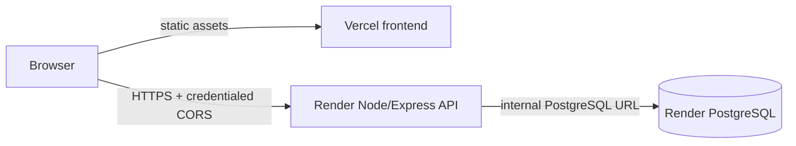

# Deployment guide

## Architecture

This checkout prepares deployment files only. No provider account was accessed, and no Render service, database, deployment, or DNS change was made.

## Before creating services

1. Review and push the branch `security/render-postgres-migration`; merge only after review.
2. Choose the cafe’s IANA time zone and a custom domain you control.
3. Use same-site domains for admin cookies: frontend `https://<cafe-domain>` and API `https://api.<cafe-domain>`. Configure the Render custom domain and DNS as Render instructs. Vercel’s `*.vercel.app` and Render’s `*.onrender.com` are cross-site, so `SameSite=Lax` cookies are not dependable across those default hostnames.
4. Use a paid/persistent Render PostgreSQL plan and configure backups before storing customer data. The Blueprint specifies paid compute plans (`0.5c-512mb` web service and `0.1c-256mb` database). Blueprint sync can create billable resources; review current price and billing first.

Render’s free Postgres expires after 30 days and has no backups, so it is temporary testing only. [Render free instance limits](https://render.com/docs/free)

## Render API and database

1. Create a Render Blueprint from the GitHub repository and select the reviewed branch with `render.yaml`.
2. Confirm service root `backend`, build `npm ci`, start `npm start`, health path `/api/health`, Node `24.21.0`, and region.
3. Review paid plans and billing before applying. `autoDeploy` is disabled; deploy manually after reviewing settings.
4. Supply prompted environment values in Render:

   - `FRONTEND_ORIGIN`: exact frontend origin with scheme and no trailing slash.
   - `ALLOWED_ORIGINS`: the exact frontend origin (add only trusted origins).
   - `CAFE_TIME_ZONE`: the real cafe IANA zone, e.g. `America/Chicago` or `Asia/Kolkata`.

   `DATABASE_URL` comes from the Render database; `SESSION_SECRET` is generated in Render. Keep these out of Vercel.
5. The server validates config, runs migrations/seeds, then binds to `0.0.0.0:$PORT`. Verify `GET /api/health` reports ready.
6. Add a Render custom domain `api.<cafe-domain>` and configure DNS using Render’s displayed record. The database allowlist is private by default. For the one-time local data import only, temporarily allowlist your current IP; see [DATABASE_MIGRATION.md](./DATABASE_MIGRATION.md).

Render web services must bind to `0.0.0.0` and use the supplied `PORT`. [Render Web Services](https://render.com/docs/web-services) The Blueprint supports PostgreSQL and references its connection string with `fromDatabase`. [Render Blueprint specification](https://render.com/docs/blueprint-spec)

## Vercel frontend

1. Import the same GitHub repository; use root as project directory.
2. Build command: `npm run build`; output directory: `dist` (also configured in `vercel.json`).
3. Set this public value in Vercel Production and Preview as needed:

   - `VITE_API_BASE_URL=https://api.<cafe-domain>`

   Vite bundles `VITE_*` values into browser assets. Never put `DATABASE_URL`, `SESSION_SECRET`, SMTP credentials, Blob tokens, or admin passwords in Vercel frontend variables.
4. Add/verify the frontend custom domain. Ensure the exact origin matches Render’s `FRONTEND_ORIGIN` and `ALLOWED_ORIGINS`.
5. Redeploy after changing `VITE_API_BASE_URL`; it is a build-time value. Check Network tools for Render API calls and no Vercel `/api` function calls.

## Cookies, CORS, CSRF

Production uses `COOKIE_SECURE=true`, `COOKIE_SAME_SITE=lax`, host-only `__Host-` cookies, exact `ALLOWED_ORIGINS`, credentialed frontend requests, and a CSRF token returned by the authenticated session endpoint. Frontend and API may be different origins but must share the same registrable domain, such as `www.example.com` and `api.example.com`. Keep the API cookie host-only; do not add a `Domain` attribute.

Do not fix a default Vercel-to-Render cross-site login by blindly setting `SameSite=None`; browsers may block third-party cookies. Use same-site custom domains and verify login, refresh, logout, and mutations in target browsers.

## Environment variables

### Render backend

| Variable | Required | Purpose |
| --- | --- | --- |
| `NODE_ENV` | Yes | `production` |
| `PORT` | Render-provided | HTTP listener |
| `DATABASE_URL` | Yes | Internal Render PostgreSQL URL |
| `SESSION_SECRET` | Yes | HMAC CSRF signing; generated in Render |
| `FRONTEND_ORIGIN` | Yes | Exact frontend origin |
| `ALLOWED_ORIGINS` | Yes | Explicit origin allowlist |
| `CAFE_TIME_ZONE` | Yes | Cafe IANA timezone |
| `COOKIE_SECURE` | Yes | `true` in production |
| `COOKIE_SAME_SITE` | Yes | `lax` for same-site custom domains |
| `TRUST_PROXY_HOPS` | Yes | `1` for Render proxy |
| `RATE_LIMIT_WINDOW_MS` | Optional | 900000 ms by default |
| `RATE_LIMIT_MAX_REQUESTS` | Optional | General public-read limit |
| `LOGIN_RATE_LIMIT_MAX`, `LOGIN_IP_RATE_LIMIT_MAX` | Optional | Per-identity and per-IP login limits |
| `BOOKING_RATE_LIMIT_MAX`, `BOOKING_CONTACT_RATE_LIMIT_MAX` | Optional | Reservation limits |
| `LOOKUP_RATE_LIMIT_MAX` | Optional | Public lookup limit |
| `DUPLICATE_WINDOW_MS` | Optional | Duplicate-contact/time window |
| `BOT_FORM_MIN_AGE_MS` | Optional | Signed form age |
| `PG_POOL_MAX` | Optional | Database pool size |

See [backend/.env.example](./backend/.env.example). `SMTP_*` and CAPTCHA secrets are omitted because those integrations are not enabled.

### Vercel frontend

Only `VITE_API_BASE_URL` is required. See [.env.example](./.env.example).

## First owner account

If you imported the Blob state, compatible admin hashes remain valid and old sessions are invalidated. For a fresh DB, run `backend/scripts/setup-owner.js` using an external DB URL and temporary IP allowlist. Set `OWNER_NAME`, `OWNER_EMAIL`, and a 16–128 character `OWNER_PASSWORD` in the local process environment; do not paste credentials into shell command history or logs. Remove the temporary DB allowlist and clear local variables after setup. The script refuses to create another active owner.

## Deployment and rollback

1. Complete the DB transfer before changing Vercel traffic.
2. Deploy/verify Render health, custom domains, and CORS.
3. Set `VITE_API_BASE_URL`, build, and deploy Vercel.
4. Smoke-test availability, booking, limited public lookup, staff login, admin refresh/status changes, owner-only Team tools, logout, and reload. Verify DB writes and rate limits.
5. Preserve the Vercel Blob source as read-only rollback snapshot.
6. If rolling back, reconcile new PostgreSQL bookings before sending traffic to old code. Old Blob state will not contain post-cutover bookings. There is no automatic reverse importer; switching blindly would lose new requests.

## Troubleshooting

- “Service not configured”: set `VITE_API_BASE_URL` in Vercel and redeploy.
- CORS/CSRF errors: compare exact origins, no trailing slash, in both providers.
- Login fails after reload: confirm custom API/frontend domains share a site and browser accepts the Secure cookie.
- Health returns 503: inspect Render logs by request ID and check DB connection/migrations.
- No active owner: use one-time owner setup; do not expose account creation publicly.
- PowerShell blocks `npm.ps1`: use `npm.cmd` as above.
