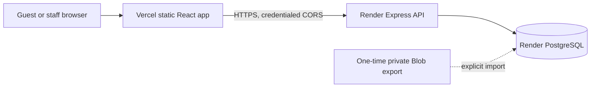

# The Corner Cafe

A React/Vite reservation website with 27 selectable tables across three floors and an independently hosted Node.js/PostgreSQL API.

## Architecture



Vercel serves only the frontend. Render runs the API and applies versioned SQL migrations at startup. PostgreSQL stores reservations, accounts, hashed sessions, rate limits, and security events. Production secrets belong in provider environment settings; `VITE_*` values are public browser configuration.

## Local development

Requirements: Node.js 22–24 and PostgreSQL. The backend loads `backend/.env`; Vite loads the root `.env.local`.

```powershell
Copy-Item .env.example .env.local
Copy-Item backend/.env.example backend/.env
npm.cmd ci
npm.cmd ci --prefix backend
npm.cmd --prefix backend run db:migrate
npm.cmd --prefix backend run dev
```

In another terminal, run `npm.cmd run dev`. Set `DATABASE_URL` in `backend/.env` to a local PostgreSQL database. Set `CAFE_TIME_ZONE` to the cafe’s actual IANA time zone. The frontend calls `http://localhost:8787` unless `VITE_API_BASE_URL` is set.

Create the first owner only when the database has no active owner. Set `OWNER_NAME`, `OWNER_EMAIL`, and `OWNER_PASSWORD` in the local process environment, then run `npm.cmd --prefix backend run db:setup-owner`. The password must be 16–128 characters. The command never prints it, and there is no public owner-bootstrap endpoint.

## Checks

After installing both dependency sets, run:

```powershell
npm.cmd run lint
npm.cmd run build
npm.cmd test
npm.cmd audit
npm.cmd audit --prefix backend
```

The suite uses PGlite for PostgreSQL-compatible integration checks. For the additional real-PostgreSQL concurrency test, set `TEST_DATABASE_URL` to a dedicated database whose name contains `test`, set `NODE_ENV=test`, and run `npm.cmd test --prefix backend`. Never point it at production.

## Deploy and security

Follow [DEPLOYMENT_GUIDE.md](./DEPLOYMENT_GUIDE.md) for Render, Vercel, cookies, domains, and environment variables. Follow [DATABASE_MIGRATION.md](./DATABASE_MIGRATION.md) before switching live bookings. Findings and remaining checks are in [SECURITY_AUDIT.md](./SECURITY_AUDIT.md) and [SECURITY_FIXES.md](./SECURITY_FIXES.md).

No Render service or Vercel deployment has been created from this checkout. Provider credentials and a private Blob export are required for live cutover.
